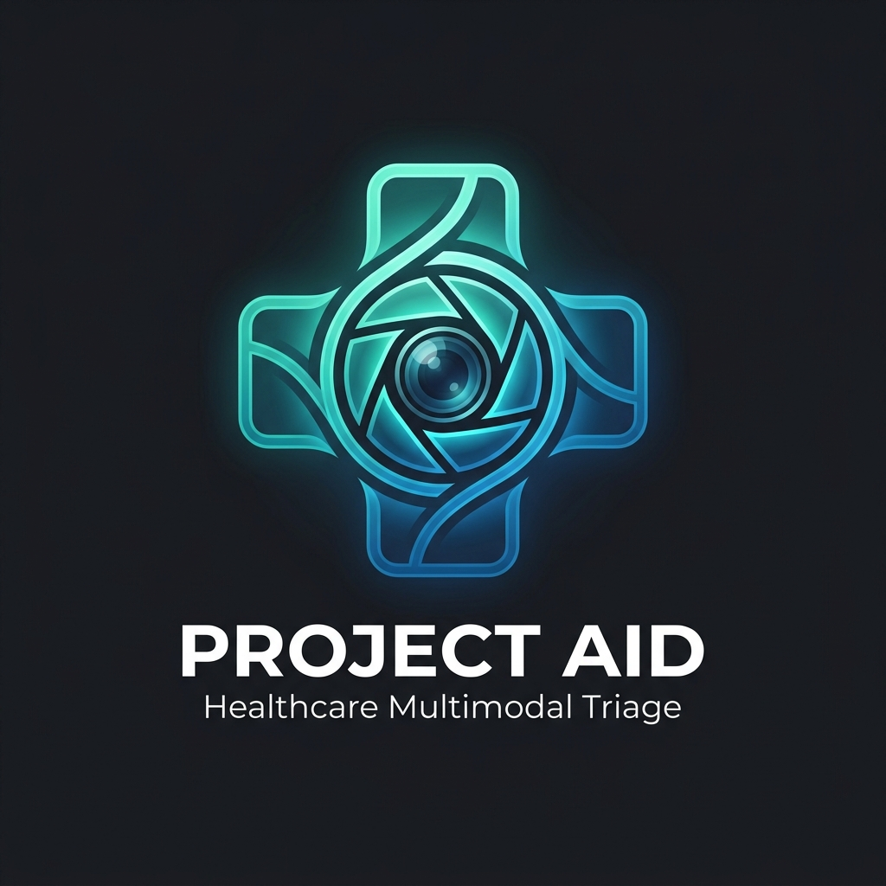

<p align="center">
  
</p>

# Project Aid: Healthcare Multimodal Triage

This repository implements the curation, verification, and audit pipeline for **Phase 1** of Project Aid, strictly aligned with [Project_Aid_Expert_Instructions.pdf](Project_Aid_Expert_Instructions.pdf).

## 1. Project Phase 1 Contract
For every task in Phase 1, exactly three elements are submitted:
1. **Clinical Image**: A single, real-world photograph (no AI, no drawings, no edits, no multi-panel grids, no watermarks, no PII).
2. **Domain**: Exactly one of the 5 canonical domains:
   - `Wound Triage`
   - `Skin Lesion Screening`
   - `Burn Classification`
   - `Rash Identification`
   - `Red-Eye Triage`
3. **Image Context Note**: A terse subject label (<= 1 short sentence, a few words) naming what the image shows (e.g., *"This is melanoma."*). Never include triage decisions, advice, or clinical reasoning.

*(Note: The prompt, target answer, clinical reasoning, and rubric are created in subsequent project phases).*

---

## 2. Directory Structure

```
Healthcare/
├── datasets/
│   ├── wound_triage/
│   ├── skin_lesion_screening/
│   ├── burn_classification/
│   ├── rash_identification/
│   └── red_eye_triage/
├── raw_downloads/            # Original unmodified image downloads
├── metadata/
│   ├── tasks.json            # Master dataset registry (Phase 1 + QA fields)
│   ├── tasks.csv             # Tabular export format
│   └── qa_results.json       # Automated audit report & flags
├── tools/
│   ├── validate_task.py      # Automated linting & rule enforcement
│   ├── deduplicate.py        # Exact SHA-256 and perceptual dHash screener
│   └── inspect_image.py      # Human reviewer CLI for task audit & approval
├── tests/
│   └── test_validation.py    # Unit tests for official examples & edge cases
├── Project_Aid_Expert_Instructions.pdf
└── README.md
```

---

## 3. Metadata Architecture

Internal tracking maintains a clean separation between **Phase 1 Submission Payload** and **Internal QA Audit fields**:

```json
{
  "task_id": "PT-0001",
  "image_path": "datasets/wound_triage/PT-0001.jpg",
  "domain": "Wound Triage",
  "image_context": "This is a superficial abrasion.",
  "source_url": "https://example.org/clinical-reference",
  "license": "Verified terms / Public domain",
  "qa_status": "pending",
  "qa_flags": [],
  "reviewer_notes": ""
}
```

- **Phase 1 Submission Fields**: `domain`, `image_path`, `image_context`.
- **Internal QA Fields**: `task_id`, `source_url`, `license`, `qa_status`, `qa_flags`, `reviewer_notes`.

---

## 4. Key CLI Commands

### Run Validation & QA Audit
```bash
python3 tools/validate_task.py
```

### Export Clean Phase 1 Submission Payload
```bash
python3 tools/validate_task.py --export-phase1 metadata/phase1_submission.json
```

### Screen for Exact & Near Duplicates (Perceptual Hashing)
```bash
python3 tools/deduplicate.py --dir datasets --threshold 6
```

### Inspect a Task and Update QA Status
```bash
# Inspect task details and technical image properties:
python3 tools/inspect_image.py --task PT-0001

# Approve a task after human verification:
python3 tools/inspect_image.py --task PT-0001 --approve --notes "Verified from CDC PHIL. Clear finding, no PII."

# Reject a task:
python3 tools/inspect_image.py --task PT-0001 --reject --notes "Watermark present in lower right corner."
```

### Run Unit Tests
```bash
python3 -m unittest tests/test_validation.py
```
